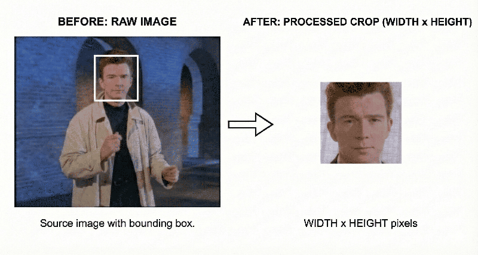
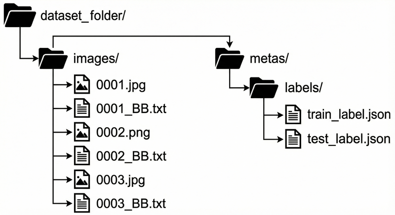

<div align="center">

# Lightweight Face Antispoof (MiniFAS, ONNX)

[](LICENSE)
[](https://www.python.org/)
[](https://pytorch.org/)
[](https://onnx.ai/)

</div>

A lightweight face anti-spoofing model that distinguishes real faces from spoofing attempts (printed photos, screen displays, etc.), originally developed for early versions of [Facenox](https://github.com/facenox/facenox).

---

## Model

The trained model is a tiny classifier that predicts two classes: **Real** or **Spoof**.

| ONNX | Quantized ONNX | PyTorch | Input | Arch |
|:---------:|:---------------:|:------------:|:-----:|:------------:|
| 1.82 MB | **600 KB** | 1.95 MB | 128×128 RGB | MiniFAS |


### Model Performance

| Metric | Model | Quantized |
|:-------|:-----:|:---------:|
| **Model Size** | 1.82 MB | **600 KB** |
| **Overall Accuracy** | **98.20%** | **98.20%** |
| Real Accuracy | 97.58% | 97.55% |
| Spoof Accuracy | 98.73% | 98.73% |
| **ROC-AUC** | **0.9984** | **0.9984** |
| **Average Precision** | **0.9987** | **0.9987** |

> Tested on CelebA Spoof (70k+ samples). Quantization has no accuracy drop.

**[Detailed metrics →](docs/METRICS.md)** | **[Previous results →](docs/PREVIOUS_RESULTS.md)**

### Native Arm64 Benchmark

The optional `Arm64 ONNX benchmark` GitHub Actions workflow compares the FP32
and INT8 98.20 models on a native Arm64 runner. Run it manually from the Actions
tab to produce downloadable JSON and Markdown receipts for model size, p50/p95
latency, and throughput. The default gate requires at least 60% model-size
reduction; optional speedup thresholds can be set when dispatching the workflow.

The workflow uses deterministic synthetic tensors to measure execution behavior,
not model quality. Accuracy claims remain based on the evaluation documented in
[Detailed metrics](docs/METRICS.md).

---

## Pre-trained

Pre-trained models are in `models/best/98.20/` (previous best: `models/best/97.80/`):

| Model | Size | Format | Use Case |
|:------|:----:|:------:|:---------|
| `best_model.pth` | 1.95 MB | PyTorch | Training, fine-tuning, PyTorch inference |
| `best_model.onnx` | 1.82 MB | ONNX | General deployment, cross-platform inference |
| `best_model_quantized.onnx` | **600 KB** | ONNX (INT8) | **Production deployment** |

---

## Why MiniFAS?

The first version used MobileNetV4 (removed; see git history). It worked, but the model was larger than necessary and the training was more complex.

MiniFAS turned out to be a better fit:
- Smaller model, faster inference
- Built specifically for anti-spoofing, not a general-purpose backbone
- Uses Fourier Transform auxiliary loss during training—this helps the model learn frequency-domain patterns that distinguish real skin texture from printed photos and screen displays
- SE (Squeeze-and-Excitation) blocks for adaptive channel attention

**[Architecture details →](docs/ARCHITECTURE.md)**

---

## Quick Start

### 1. Create and activate a virtual environment (Recommended)

**Using Conda:**
```bash
conda create -n face-antispoof python
conda activate face-antispoof
```

**OR using venv:**
```bash
python -m venv venv
# Linux/macOS
source venv/bin/activate
# Windows
venv\Scripts\activate
```

### 2. Install dependencies

Requires **Python 3.10+** (tested on 3.11). Versions are pinned.

```bash
pip install -r requirements.txt        # inference + demo (numpy, opencv, onnxruntime)
pip install -r requirements_train.txt  # + training, export, data prep (torch, ...)
pip install -r requirements_dev.txt    # + pytest, ruff
```

> **Note:** To run on GPU, install `onnxruntime-gpu` instead of `onnxruntime`. For CPU-only torch,
> add `--extra-index-url https://download.pytorch.org/whl/cpu`.

### Run the Demo

**Webcam:**
```bash
python demo.py
```
or

```bash
python demo.py --camera <index>
```

**Single image:**
```bash
python demo.py --image <path>
```

Green bbox = real.
Red bbox = spoof.

`--threshold` (default 0.5) is the real-probability cutoff; raise it for stricter checks.

---

## Training

Run scripts as modules from the repo root (`python -m scripts.<name>`) so `src` is importable.

### 1. Prepare the Dataset

The dataset needs:
- Face images (`.jpg` or `.png`)
- Bounding box files: for `image.jpg`, a corresponding `image_BB.txt` with `x y w h`
- Label files: `metas/labels/train_label.json` and `metas/labels/test_label.json`



Run the prep script to crop faces:

```bash
python -m scripts.prepare_data \
  --orig_dir <path> \
  --crop_dir <path> \
  --size <number> \
  --bbox_expansion_factor <float> \
  --spoof_types <number> [<number> ...]
```

This reads images, crops faces using the bounding boxes (with some padding), resizes to the specified size, and organizes everything into `train/` and `test/` folders.

→ [**Why these preprocessing choices?**](docs/DATA_PREPARATION.md) (interpolation methods, padding strategy, etc.)



### 2. Train

```bash
python -m scripts.train \
  --crop_dir <path> \
  --input_size <number> \
  --batch_size <number> \
  --output_dir <path>
```

Checkpoints and TensorBoard logs go to `<output_dir>/MINIFAS/`. If `checkpoint_latest.pth`
exists there, training resumes from it automatically.

**Resume from a specific checkpoint** (add `--transfer_learning` to load weights only, with a
fresh optimizer):
```bash
python -m scripts.train \
  --crop_dir <path> \
  --resume <checkpoint_path>
```

### 3. Prepare Model

Extract clean model weights from checkpoint (removes optimizer state, FTGenerator, DataParallel prefixes):

```bash
python -m scripts.prepare_best_model <epoch_checkpoint> \
  --output <path> \
  --input_size <number>
```

This creates a clean, inference-ready PyTorch model.

### 4. Export to ONNX

```bash
python -m scripts.export_onnx <checkpoint_path> \
  --input_size <number> \
  --output <path.onnx> \
  --quantize            # also write <path>_quantized.onnx (INT8)
```

---

## Development

```bash
pytest          # includes golden-output tests: logits on assets/docs/face.jpg must not change
ruff check . && ruff format --check .
```

CI runs both on every push and pull request. Training checkpoints (`models/checkpoints/`) are
not tracked in git.

---

## Repo Structure

```
├── demo.py              # Inference demo
├── src/
│   ├── detection/       # Face detection
│   ├── inference/       # Model inference
│   └── minifasv2/       # Model + training code
├── scripts/             # Data prep, training, export
├── tests/               # pytest suite (incl. golden outputs)
├── models/
│   ├── best/<acc>/      # Released .pth / .onnx / quantized .onnx
│   └── detector*.onnx   # YuNet face detector
├── docs/                # Documentation
└── assets/              # Demo assets & results
```

---

## Limitations

Works best with well-lit, frontal faces. See [**Limitations & Notes**](docs/LIMITATIONS.md) for edge cases and tips.

---

## Acknowledgment

This project is based on the MiniFAS architecture from the
Silent Face Anti-Spoofing project by Minivision AI, licensed under Apache-2.0.

> This repository provides an independent training pipeline, ONNX export,
quantization, and deployment tooling.

---

## License

Apache-2.0. See `LICENSE`.
